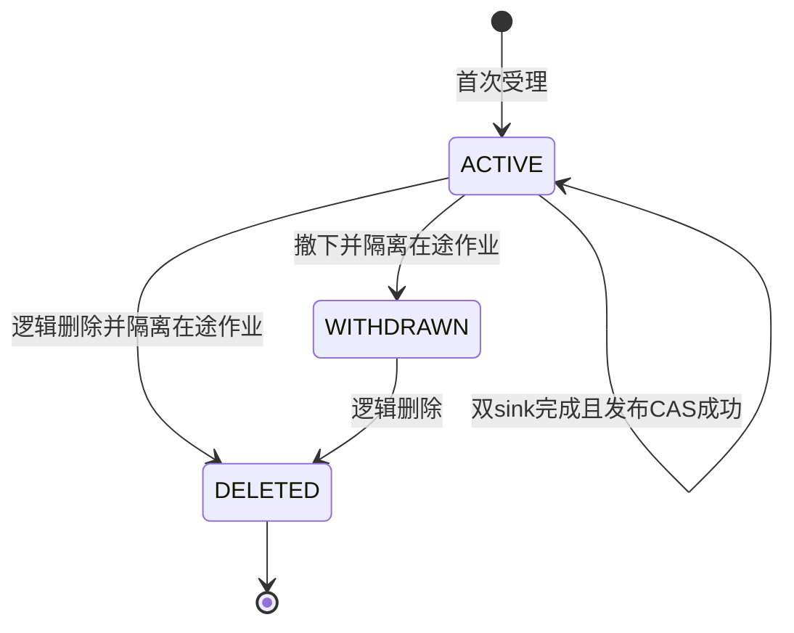

# 文档生命周期契约

协议标识：`knowledge-lifecycle-v1`，S10A，2026-10-25。本文是 C-LIFECYCLE 的唯一正式语义；架构归属见[目标架构](../platform-selection-20261020/BACKEND_ARCHITECTURE.md)。**设计已定义不代表端点已实现**：S9D只扩展处理profile，S10B实现更新与发布，S10C实现撤下/逻辑删除及历史读取保护，S10D实现同内容重索引。生产清理未授权。

## 1. 五种身份与不变量

| 名称 | 稳定含义 | 谁改变它 |
| --- | --- | --- |
| documentId | 同一份逻辑资料，canonical UUID | 首次受理生成，更新不换ID |
| contentRevision | 不可变原文件修订；原K02.version、K04.version继续表示此值 | 新内容受理递增；失败也不复用编号 |
| publishedRevision | 当前可检索内容修订，可空 | 双sink成功后短事务切换，绝不等同最新受理修订 |
| indexGeneration | **每个文档内**单调递增的处理代次，与内容修订独立 | 初次受理、更新、显式重索引各分配一次；原任务重试不增加 |
| processorVersion | 闭合处理算法profile，绑定解析/分块/Embedding模型与维度 | 新作业受理时冻结；恢复不跟随配置改变 |

文档还有`revision`（管理命令乐观锁）和任务`revision`、`leaseEpoch`；三者均不代表内容版本或索引代次。整数限定1..2147483647（revision可从0），耗尽拒绝、不回绕。时间为UTC ISO 8601/数据库微秒。枚举持久/API使用显式稳定code，拒绝未知值、ordinal和隐式类型转换。

- INV-01：Knowledge MySQL是文档可见性、内容修订、任务/代次和发布指针的唯一权威；S3、ES、Qdrant和Python均不能自行发布。
- INV-02：发布是`(documentId, publishedRevision, publishedGeneration, publishedJobId)`的一次原子切换；三项发布值全部为空或指向同一个已完成作业，源hash、profile、准备批次必须一致。
- INV-03：一个文档至多一个当前处理意图`activeJobId`；准备/索引失败不改变旧发布指针。新受理可以取代已终止失败的意图，不能取代正在执行的意图。
- INV-04：恢复保留原文件、profile、代次、已接受提取物/准备包和已完成sink。旧任务即使仍持有有效租约，也不能覆盖已改变的activeJobId、发布基线或可见性。
- INV-05：未发布、已撤下或已删除资料不能经检索、直接引用、来源、评测或历史结果正文绕过。历史不可变数据的存在不构成当前读取许可。
- INV-06：更新、重试、撤下和逻辑删除都不物理删除原文、准备包、索引、checkpoint或备份；清理必须是独立且尚未启用的流程。

## 2. 状态、事件、守卫和效果

文档生命周期`ACTIVE / WITHDRAWN / DELETED`与作业`RECEIVED / PROCESSING / READY / FAILED`正交。READY描述该作业曾成功发布，不表示其仍是当前发布代次。`SUPERSEDED`为查询派生的历史关系，不伪装为新的成功任务状态。

| 事件 | 前置状态/守卫 | 同库提交效果 | 外部副作用与失败 |
| --- | --- | --- | --- |
| CREATE | 原K01幂等/查重/受理规则 | ACTIVE；内容1/代次1；activeJobId；发布为空 | 原文件先落S3，再登记；未知提交先查原键 |
| ACCEPT_UPDATE | ACTIVE；expectedRevision一致；无RECEIVED/PROCESSING当前任务；新hash与最新内容不同 | 新内容修订和新代次；保存当前发布基线；revision+1；旧发布不变 | 不在事务中解析/向量化；处理失败保留旧版 |
| ACCEPT_REINDEX | ACTIVE且有当前发布；同上并发守卫；明确目标profile | 内容修订仍取**当前发布版**；新代次/作业；保存基线；revision+1 | 不读取未发布失败稿；已接受准备包只属于该新作业 |
| CLAIM / PREPARE / SINK_DONE | job输入及未过期lease owner/epoch一致；仍为合法当前意图 | 原任务推进；保存提取/准备指针、逐sink凭据 | 外部IO在事务外；失租不确认、不发布 |
| PUBLISH | ACTIVE；activeJobId相等；保存的发布基线未变；当前lease有效；两sink DONE且批次相同 | CAS发布三元组；job READY；文档revision+1；审计同事务 | 任一CAS影响行数不为1全部回滚；不先宣告READY |
| FAIL | 仍持有合法lease | 只变job FAILED；文档发布指针不变 | 安全错误码/是否可重试；不改旧发布正文 |
| RETRY | ACTIVE；job为当前意图；FAILED+retryable；expectedJobRevision一致；次数未满 | 原job回RECEIVED；保留同一内容/代次/profile/已完成副作用 | 已被新意图取代的任务返回409；不启动新文件任务冒充重试 |
| WITHDRAW | ACTIVE；expectedRevision一致；owner写权限 | lifecycle=WITHDRAWN；activeJobId清空；revision+1；审计 | 正文立即按权威读取不可见；保留发布指针用于审计，指针存在不授予读取 |
| DELETE | ACTIVE或WITHDRAWN；expectedRevision一致；owner写权限 | lifecycle=DELETED；activeJobId清空；revision+1；审计 | 逻辑墓碑；无对象/索引/备份删除；同键重放原回执 |

WITHDRAWN/DELETED不接受更新、重试、重索引或隐式再发布。此阶段没有恢复/取消删除接口；重新上传由S10E的独立新documentId规则处理，不能把旧任务重试当恢复。需要恢复原ID时另定义显式业务命令，不能由worker推断。

撤下/删除与worker统一按`document → ingestion → chunks/events`顺序加锁。领取候选可先无锁有界选ID，再按此顺序短事务验证并领取；禁止沿用“先锁job、后锁document”与撤下形成反序。心跳只锁job且不再申请document锁。事务不用远程调用；失效任务终止为FAILED、`KNOWLEDGE_STATE_CONFLICT`、retryable=false，审计说明被哪个已受理命令隔离，不能写回文档状态。



## 3. 管理读模型与命令 K07

沿原Gateway可信身份和`knowledge:read/write`、tenant/owner隔离；不给runtime只读身份管理权限。新管理模型走`/api/v2/knowledge`，保留K01–K06旧形状，避免给严格消费者静默增加字段或改变status枚举。新字段全部必需，可空显式null。

`DocumentLifecycleView={documentId,revision,lifecycle,latestContentRevision,publishedRevision,publishedGeneration,activeJobId,displayName,contentType,sizeBytes,contentHash,createdAt,updatedAt}`。displayName等内容字段来自latestContentRevision不可变记录；发布版的名称、格式和摘要必须从对应内容修订读取，不能借用失败新稿的名称。

| 方法/路径 | 请求 | 返回与边界 |
| --- | --- | --- |
| GET `/api/v2/knowledge/documents` | limit缺省20、1..100；opaque cursor | `{items:DocumentLifecycleView[],nextCursor}`；按documentId稳定游标、tenant/owner过滤；含ACTIVE/WITHDRAWN，不列DELETED |
| GET `/api/v2/knowledge/documents/{id}` | 无 | 200 DocumentLifecycleView；owner可读ACTIVE/WITHDRAWN管理元数据；DELETED公共详情404，原命令回执仍可查询 |
| GET `/api/v2/knowledge/documents/{id}/revisions` | limit缺省20、1..100；opaque cursor | `{items:[{contentRevision,displayName,contentType,sizeBytes,contentHash,createdAt}],nextCursor}`；按修订倒序，cursor绑定owner/doc和最后修订，不返回历史原文 |
| GET `/api/v2/knowledge/documents/{id}/generations` | 同上，按generation倒序 | `{items:[{indexGeneration,contentRevision,jobId,processorVersion,status,isCurrentPublication,wasPublished,errorCode,retryable}],nextCursor}`；isCurrentPublication是当前指针比较，不由READY猜测 |
| POST `/api/v2/knowledge/documents/{id}/updates` | Idempotency-Key；multipart file/displayName/expectedRevision | 202 CommandReceipt；文件/MIME/上限完全沿K01与P-v2；同字节改名不创建内容版本，返回409 STATE_CONFLICT |
| POST `/api/v2/knowledge/documents/{id}/withdrawals` | Idempotency-Key；JSON `{expectedRevision}` | 200 CommandReceipt；撤下不是物理清理 |
| POST `/api/v2/knowledge/documents/{id}/deletions` | 同上 | 200 CommandReceipt；明确逻辑删除，客户端不得展示“永久抹除” |
| POST `/api/v2/knowledge/documents/{id}/reindexes` | Idempotency-Key；JSON `{expectedRevision,expectedPublishedGeneration,processorVersion}` | 202 CommandReceipt；仅闭合已验证profile；S10D前不开放 |
| GET `/api/v2/knowledge/commands/{key}` | 原规范幂等键，owner范围 | 200 CommandReceipt；未找到404；不得返回文件、正文或存储路径 |

`CommandReceipt={commandId,operation,documentId,acceptedRevision,contentRevision,indexGeneration,jobId,acceptedAt}`；operation为`UPDATE/WITHDRAW/DELETE/REINDEX`；撤下/删除的contentRevision/indexGeneration/jobId均null。回执是不可变受理事实，当前运行状态另查K03/K07；重放不把受理时间伪装成刚完成。

新管理命令键沿原ASCII `[A-Za-z0-9._:-]{16,128}`规范，作用域`(tenant,owner,key)`在新生命周期命令表内独立；不能与K01旧键混淆恢复入口。指纹绑定operation、documentId、expectedRevision、原始sourceHash、规范格式和名称，重索引还绑定expectedPublishedGeneration与目标profile。先核对现时owner授权，再查同键回执；同键同完整输入重放，即使当前revision已推进也返回原回执；同键异参409 IDEMPOTENCY_CONFLICT。不同键遇到旧revision或不合法状态409 STATE_CONFLICT。对DELETED允许原owner查询/重放已有无正文命令回执，不重新创建或暴露文档元数据。

上传S3后发生冲突保留孤立候选，不立即删除共享hash对象；数据库唯一命令键裁定并发赢家。请求响应未知先GET原键，不换键重发；确认未找到时只可重发完全相同输入。新命令表、版本记录、job、文档CAS、审计同短事务。

复用KnowledgeError/PlatformError：输入400、文件过大413、格式415、无权/不存在404、状态/幂等409、容量429、存储/数据库/索引不可用503。不得依提示文本分支；暂无必要新增平行错误目录。

旧K02.version仍为最新受理内容修订、status为该受理任务状态、publishedVersion仍为当前发布内容修订，不得悄悄把version改为publishedVersion；ACTIVE下更新失败可以出现version=2/status=FAILED/publishedVersion=1。新工作台必须消费K07同时展示这两种事实，不能沿旧页面status!=READY就断言旧发布版不可用。旧K02/K03不增加字段；K02不返回WITHDRAWN/DELETED，K03只在ACTIVE下返回安全任务元数据，retryable还需当前意图守卫。所有更新入口在新UI/消费端兼容验证后才启用。

旧ingestionJobId保持“最新内容修订首次受理任务”，显式重索引不覆盖它；K07.activeJobId才代表正在管理的处理意图。因此最新失败稿v2存在时，重建已发布v1不会把旧K02.version倒退为1。列表和历史游标必须绑定owner、documentId及排序边界，不能凭他人游标扩大查询范围。

## 4. 发布读取、旧引用与历史输出

K04/K05检索和直接引用、K06来源仍只读当前可见发布代次；所有权、lifecycle=ACTIVE、publishedRevision/generation/job、job成功发布、batchDigest、sourceDigest/profile兼容必须共同通过。新DTO内部包含generation，旧Hit外形不增加字段；新chunkId本身绑定generation，不会把旧URL重新解释成新代次。

| 场景 | 检索/引用/来源 | 历史QA、研究、助手及评测 |
| --- | --- | --- |
| 新内容处理失败 | 仍是旧发布版 | 旧结果可用；详情标明新稿失败，不能说资料不可用 |
| 新内容成功切换 | 只返回新发布版；旧版本引用404 | 保留不可变审计；公共历史结果的引用重验失效，隐藏生成正文并说明资料版本已变化 |
| 同内容重索引成功 | 只返回新代次；即使version未变，旧chunkId也404 | 旧评测绑定不能自动转移到新片段；显示需重绑定/重新评测，不复制旧分数 |
| 撤下/逻辑删除/当前无权 | 所有正文与来源404；管理元数据遵K07 | 不返回历史答案、摘要、引用标题、报告正文、事件TEXT_DELTA或checkpoint内容 |
| Knowledge权威不可用 | 503；不回旧缓存正文 | 503/不可验证；不能当作“已删除”或沿用上次授权 |

这里选择保守的**当前发布版本读取政策**，与现有K04/K06一致；不默认开历史原文浏览。未来业务若要求历史版本可读，需独立授权、保留和UI契约，不能修改本次规则来绕过撤下。

S10B更新启用前，Tasks公共读取、Conversation上下文、React历史展示必须能处理版本失效；S10C启用前完整覆盖撤下/删除与历史事件。Tasks仍拥有原始结果/摘要，不改写不可变终态，也不把内容授权塞进中央任务状态机。由Tasks的知识结果读取适配调用Knowledge判权，不能只在React隐藏。原内部worker对账可读取必要不可变凭据，但向模型/用户交付前重新判权。

K08内部只读批量校验：`POST /internal/v1/knowledge/citations/check`，请求`{references:[{documentId,version,chunkId}]}`，1..20唯一引用，≤32KiB；返回`{accessible:boolean}`，无正文/标题/存在原因。全部引用当前可读才true；任一不存在、跨owner或失效均false；非法类型/格式400、依赖故障503。Tasks使用独立角色：iss=`urn:agentic-ai:task-knowledge-reader`、aud=`agentic-ai-knowledge`、azp=`async-task-service`、scope=`knowledge:citations:check`；tenant/sub取经验证的任务owner，RS256签名、iat/nbf/exp必需且TTL≤60秒，无时间宽限。不能搜索/管理；具体密钥部署复用现有受控方式，不把Gateway或worker密钥共享过去。Runtime继续K05，不被授予K08服务角色。连接/在途≤2，单次以及整次公开读取总期限均≤15秒，单批响应≤32KiB，无自动重试或跨请求权限缓存；列表最多扫描原limit+1行，未完成校验就503，不能越过截止时间。

公共T01原shape不改变：有知识结果/事件的GET在校验失败时返回统一404；依赖失败503。列表读取有界过滤不可见行，游标按**实际扫描的最后一行**推进，不无界补满；第一页可空但nextCursor非空。前端保留当前筛选/可继续翻页。SSE历史和实时在发出正文事件前同样检查，不能仅保护最终result。既有终态从已验证结果schema提取引用；活动任务须在首次正文事件前，以合法lease登记有界证据引用清单，恢复/引用变化后重验；没有清单的旧活动任务只发安全状态，不回放正文。未来适配须同时处理直接任务读取和Conversation聚合返回，不留旁路。

T01的知识证据扩展由Tasks拥有：`POST /internal/v1/tasks/{taskId}/knowledge-evidence`，原worker签名/租约身份，正文`{epoch,operationKey,references}`；引用形状沿K08，QA最多5条、研究/助手最多10条，返回`{taskId,epoch,evidenceDigest}`。按原lease与幂等operationKey一次持久登记；同epoch清单只允许增加，不能缩减来绕过先前正文依赖。digest为H(joinLF按documentId/version/chunkId排序的`documentId:version:chunkId`行)，并纳入原事件/结果提交前检查；最终引用必须是已绑定清单的子集。事件正文绑定产生时的epoch与证据清单，重放也按该清单校验；无清单的旧TEXT_DELTA一律不重放，即使终态存在，避免把最终未采用的来源隐藏依赖漏掉。已验证的NO_EVIDENCE固定无资料说明和纯状态事件无需伪造引用调用K08；未知结果schema不输出正文。EVALUATION内部凭据继续原协议，评测正文由Knowledge自己的绑定校验保护。

撤下的线性化点为Knowledge事务提交；读取在其最后一次权威校验时决定可见性。提交后开始的新读取必须拒绝；已在此前返回、已展示或已发送给模型的字节无法追回。无跨服务原子“撤权并撤回网络数据”承诺。客户端收到失效/404后立即丢弃旧正文缓存；模型外发前、恢复前、最终交付前继续既有重验。活动流在下一次发出事件前重验并停止，不能声称已经显示的内容被物理删除。

## 5. 准备协议与代次身份 P05

S9D使用新算法profile和原P01/P04形状，仍是首次入库；不在原profile上替换算法，不预建生命周期表。S10B开始使用代次封装，旧已受理任务/金标按旧schema原样读取。P05为`POST /internal/v3/knowledge/prepare`，复用P01同一身份、并发额度、总期限和≤6MiB限制。

请求`{tenantId,ownerId,documentId,jobId,documentVersion,indexGeneration,processorVersion,contentType,sourceHash,sourceText,extraction}`。TXT/MD只有sourceText非null，按P01原始UTF8校验；PDF/DOCX只有extraction非null，沿P04验证。未知组合在模型调用前拒绝。profile与输入格式匹配；schema注册必须把“可读取集合”“新受理默认”“显式重索引目标”分开，不再用MIME唯一映射拒绝历史profile。

返回`{schemaVersion:"knowledge-generation-preparation-v1",tenantId,ownerId,documentId,jobId,documentVersion,indexGeneration,sourceHash,extractionDigest,processorVersion,embeddingModel,dimensions,chunks,batchDigest}`。chunk为`{ordinal,chunkId,text,textHash,startByte,endByte,segments,sourceDigest,vector,vectorHash}`：原文本有startByte/endByte、segments=null；结构文本两个offset为null、segments为P04有序真实区间。所有算法/大小/来源覆盖、向量格式沿被选profile原契约；提取摘要对TXT/MD为null，不能造解析器。

新增身份公式，H/joinLF及binary64沿P-v2：

```text
textSourceDigest = H(joinLF("utf8-segment-v1", sourceHash, startByte, endByte))
structuredSourceDigest = 原P04 sourceDigest
chunkId = H(joinLF("generation-chunk-v1", tenantId, ownerId, documentId,
                  documentVersion, indexGeneration, sourceHash, extractionDigestOrDash,
                  processorVersion, ordinal, textHash, sourceDigest))
batchDigest = H(joinLF("knowledge-generation-preparation-v1", tenantId, ownerId,
                      documentId, documentVersion, indexGeneration, processorVersion,
                      embeddingModel, dimensions, sourceHash, extractionDigestOrDash,
                      "chunks", joinLF(each chunkId + ":" + sourceDigest + ":" + vectorHash)))
```

旧ID/批次永不重算或回填；新请求同一代次重试产生相同文本身份，首次合法准备包绑定后不再调用Embedding。首次调用后尚未持久接受就崩溃仍可能重复费用，账本保留未知预留，不承诺模型exactly-once。同内容不同代次的chunkId和batchDigest均不同；ES/Qdrant沿现有chunkId+batchDigest对象身份，迟到旧worker只能写旧代次，不能覆盖新代次对象。

## 6. 重索引、对照与切换门槛

REINDEX只冻结当前发布内容修订、原sourceHash、目标profile、当前发布基线和新generation。S3原文件按hash复核；相同parser可复用已核验且内容/profile完全匹配的提取物，不能把旧准备向量改标签当新profile。新任务第一次合法prepared指针绑定后，故障恢复复用它和逐sink结果。更新与重索引共用单文档当前意图，竞争时一方409，不开两条可互相覆盖的流水线。

发布前核对：全部chunk唯一且来源覆盖、数量1..100不截断；两sink逐项成功并抽/全量读回本批ID/摘要（当前最多100，采用全量核对）；无跨代混批；同一固定语料的profile比较、可读旧profile及负例验证；当前source权限/lifecycle与发布基线未变。新算法受控对照只证明机制；U01真实业务质量未知不能声称提升。语料/标注必须保持输入版本；chunk改变要显式重新标注，旧baseline原样保留。

旧代索引暂存可能挤占候选。S10D读取采用有界扩大候选：每路依次20、60、100，保留各原始排名后融合，权威过滤后仍不足且存在被淘汰候选时返回现有INDEX_UNAVAILABLE/503，不把候选耗尽伪装无答案；没有淘汰候选的真实不足正常返回。单次总期限仍沿原请求预算，不每轮重置；共用一次查询Embedding。S11A后续改为其授权候选原语时必须证明等价。此处不引入全量扫描、无限补召回或自动物理清理。

## 7. 迁移与上线顺序

1. **S9D**：只追加新profile允许集合/受理选择与对应真实校验；旧profile、JSON和ID保持可读。无需生命周期占位SQL。
2. **S10B扩展**：新增不可变`knowledge_document_revision`、生命周期命令/审计记录；复用ingestion作为generation记录，新增index_generation和受理时发布基线；document新增lifecycle/revision/last_generation/published_generation/published_job_id/active_job_id。last_generation在文档锁内分配下一代，即使任务失败也不回退，不能用published_generation+1导致失败代次复用。现有version保持最新受理修订；内容修订保存首次受理jobId。每表/字段中文注释，MyBatis XML写SQL。
3. **约束迁移**：去掉READY时published_version必须等于最新version的旧CHECK，改发布元组完整及关联约束；job由“一文档一内容版本”唯一改为“一文档一代次”；chunk ordinal唯一改为job+ordinal，旧chunk主键保留、新P05 ID不碰撞。内容修订按tenant/owner/doc/version唯一；全部关联包含owner/tenant，拒绝串租户引用。EvaluationMapper.bindings现有d.content_hash必须改为已发布内容修订的hash，不能拿失败新稿摘要使旧发布评测意外失效。
4. **回填**：已存在每个文档version=1、generation=1；从实际job复制内容元数据/profile/对象指针，不补造成功；READY才填发布元组，失败/排队保持null。旧chunk/金标/账本/任务输入和digest不重写。按documentId有界断点、先统计hash与行数，再启用写路径；来源不一致立即停，不按status猜。
5. **受理升级窗口**：先停Knowledge新受理和worker、排空/保存在途，再扩展/回填并部署能读新旧schema的Java/Python。旧writer不得与新生命周期writer并行。完成真实DB/旧数据/消费者验证后先启用P05新受理，再开启更新；先交付历史结果读取保护，再开放会导致旧引用失效的更新操作。共享Tasks/Conversations受影响制品须分阶段更新，不能覆盖活动JAR。
6. **S10C**：撤下/逻辑删除开关默认false，完整正文/历史事件/评测/上下文授权适配通过后才开；owner管理返回与无权404分别验证。不会自动撤下用户旧资料，只用隔离测试对象验证。
7. **S10D**：同版多代重建启用前验证两代共存、同profile重建、索引过期副作用、候选有界恢复及指针CAS。S10E再替换全owner-content唯一去重为只约束活跃最新内容的策略；S10B/C在旧唯一约束下返回明确冲突，不能谎称删除后已支持重复上传。

迁移编号在对应实现时按真实Flyway最新版本串行分配，不预占V9或修改V1–V8。S10A无SQL、无回填执行。扩展/回填期间旧代码只有在不产生新修订/新代次/撤下墓碑时才可回退；一旦启用新业务语义，最小回退是保留可读新schema及lifecycle的应用版本并关闭新命令/worker，不能退回只识别v1的程序。备份还原必须先重放撤下/删除墓碑及权限，再允许检索；代码回滚不能撤销已完成更新。

## 8. 保留和清理资格（U07未决）

目前全部保留，不自动物理删除。待业务逐项确定：原文件/提取物/准备包/旧索引/失败孤立对象、评测与任务结果/checkpoint、审计/日志、备份的期限、保留例外、删除传播及恢复要求；不虚构统一天数、法定义务或RTO/RPO。

未来清理候选必须同时证明：不为当前发布/当前任务依赖；无有效lease/在途未知写；无内容寻址共享引用；不被需保留的评测/结果/checkpoint/审计依赖；保留期满足且无保留例外；目标namespace与manifest明确；有独立批准和可验证回执。仅“旧generation”“FAILED”“DELETED”任何单一条件都不够。先标记、再次核对引用/权限和代次、逐目标有界执行、记录可恢复检查点；无权对备份做删除承诺。此段不授权本Agent实际清理。

SKILL_HANDOFF: public-engineering-workflow/Contracts阶段，slice=S10A；消费架构决策D-LC01–08；本契约交S9D与S10B–F，实施前以[LIFECYCLE_ACCEPTANCE](LIFECYCLE_ACCEPTANCE.md)逐项证明，不能把设计表当产品PASS。
