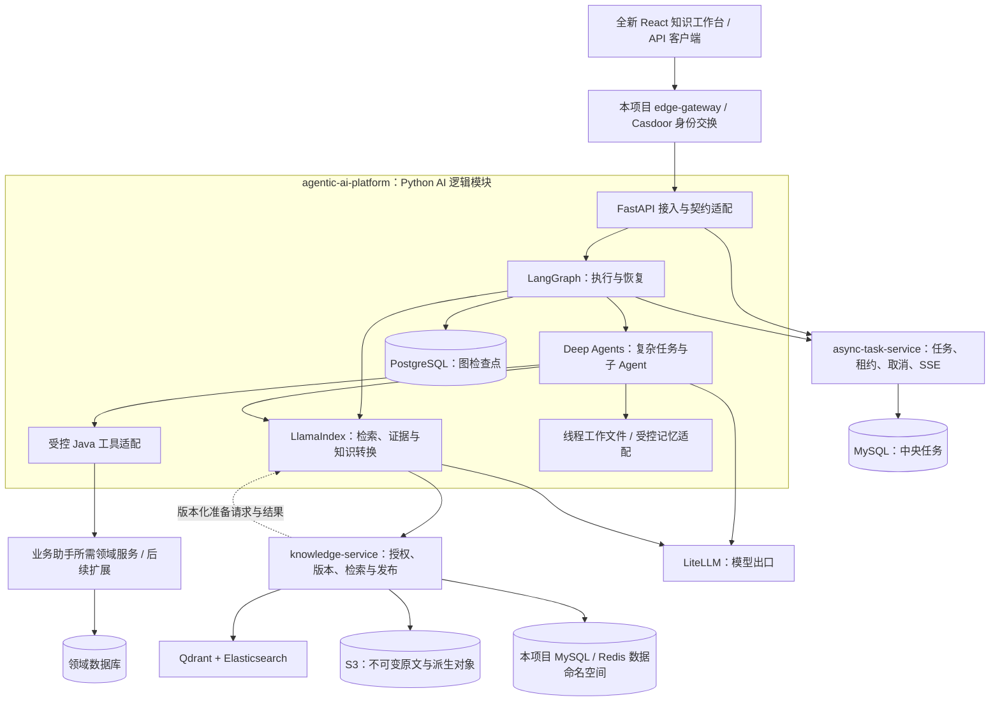

# 平台目标架构：LangGraph、Deep Agents、LlamaIndex

日期：2026-10-20。Java 取证基线：`468cec4`；关联 Python 仓库取证基线：`7738cb7`。

**已确认基线：独立知识平台，采用全新 React 前端、Python AI 核心与按需迁入本项目的 Java 领域能力。LangGraph 统一执行与恢复，Deep Agents 承载复杂 Agent，LlamaIndex 承载知识处理与 RAG。**

S2 的 LangGraph/LlamaIndex 准备图已接入真实 Embedding；S3 由 Java 持久化准备包、执行带代次的租约处理、提交 Qdrant/ES 并原子发布文档/任务，提供授权检索和原文引用。跨进程故障恢复已验证，Python 不持有业务库或索引写权限。当前短图无 checkpoint；Deep Agents 仅完成隔离兼容验证，PG 长任务恢复和研究 Agent 尚未交付。契约见 [P01/P02 与 S3](../knowledge-first-20261020/PROCESSING_CONTRACTS.md)。

这是新项目 `agentic-ai-platform` 的目标设计；已开始实施 S0 AI 运行基础与 S1 知识资料受理/查询，尚未完成三框架业务闭环。用户已确认架构与组件，并进一步明确独立运行、全新 React 前端、知识业务优先及按需迁入资产，见[首期业务与工程约定](../knowledge-first-20261020/BRIEF.md)。下文事实表中的“已有/当前”指参考项目；“迁入/沿用”表示复用代码与能力，不表示必须依赖旧项目正在运行的业务服务。组件、版本、候选取舍见 [TECH_SELECTION](TECH_SELECTION.md)，历史背景见[可行性分析](../../feasibility/AI平台升级可行性分析.md)，真实实施/验证状态见[当前进度](../knowledge-first-20261020/PROGRESS_STATE.md)。

S5A 已实现本项目 `async-task-service`：独立 MySQL 任务库、租约代次、持久事件、显式取消/恢复和幂等终态报告。参考旧中央任务语义按范围裁剪，未迁入内存权威、旧 DAG、Kafka 或 webhook。检查点提交凭据由有效租约保护；PG 准备写仍未接入，联合 fencing 与图恢复必须在 S5B 通过真实验证。契约见 [T01](../knowledge-first-20261020/TASK_CONTRACTS.md)。

## 1. 目标、主作业与范围

本方案面向新平台的知识问答、研究与分析 Agent、业务助手和知识入库，复用参考项目中的业务与治理能力：

| 主作业 | 目标行为 | 必须保留的不变量 |
| --- | --- | --- |
| 用户基于企业资料提问 | LlamaIndex 组织检索、重排、证据与回答 | 检索与引用不能跨租户、跨当前授权范围；生成文本不能伪装原文 |
| 用户提交复杂研究/分析任务 | Deep Agents 规划与委派，LangGraph 保存执行状态 | 预算有界；取消、恢复、重复请求不能产生非法业务效果 |
| 管理员上传或更新文档 | LlamaIndex 逐步承担知识转换，复用成熟解析与发布链路 | 内容去重、版本、来源、逐存储目标状态、失败恢复继续有效 |
| 用户通过业务助手查询资料、解释业务或准备任务材料 | Python 调用本项目受控领域工具；首轮具体工具清单需细化 | Java 拥有业务规则、事务与最终权限；审批和幂等不能依靠模型自律 |

首期优先覆盖知识入库、知识问答、研究分析和业务助手，前端使用全新 React 工程并遵循既定配套。所需 Java 领域代码、依赖、迁移和测试按功能迁入；后续业务参考 AgentScope。独立性以不访问旧业务部署也能完成本项目闭环为验收方向，允许显式接入 dev_infra、身份平台及模型等外部基础服务。S1 已建立本项目独立 MySQL/S3 资源与 Java 服务，原文和受理任务真实持久化；历史业务数据未导入，生产部署未执行。知识服务拥有 `knowledge_document` / `knowledge_ingestion`，网关没有业务数据访问权限。

## 2. 事实、假设与约束

| ID | 类型 | 内容与证据 |
| --- | --- | --- |
| F01 | Fact | Java 21、Boot 3.3.5、Cloud 2023.0.3、LangChain4j 1.13.1、MyBatis-Plus 3.5.17，见[根 POM](https://github.com/lirji/langchain4j-platform/blob/468cec425dd160e80cfc3ab378d3440a8767e4d5/pom.xml) |
| F02 | Fact | `/agent/**` 和 interop 默认指向 Python AgentScope；旧 Java Agent 是显式整服务回滚目标，见 [Compose](https://github.com/lirji/langchain4j-platform/blob/468cec425dd160e80cfc3ab378d3440a8767e4d5/deploy/docker-compose.yml)、[切换手册](https://github.com/lirji/langchain4j-platform/blob/468cec425dd160e80cfc3ab378d3440a8767e4d5/docs/Agent%E7%BC%96%E6%8E%92/agentscope-full-cutover.md) |
| F03 | Fact | Python 当前以 AgentScope 2.0.5、FastAPI、Pydantic、HTTPX 构建，Python 约束为 `>=3.12,<3.14`，见[固定版本依赖声明](https://github.com/lirji/platform-agentscope/blob/7738cb7bedd1a31fd4260aa66b74572ca48d9ade/pyproject.toml) |
| F04 | Fact | 当前中央任务服务拥有 Agent 任务、租约、SSE 与 webhook；已有 api/worker 只读恢复和中央 DAG 检查点，不能当作尚未建设，见[当前异步运行手册](https://github.com/lirji/platform-agentscope/blob/7738cb7bedd1a31fd4260aa66b74572ca48d9ade/docs/async-orchestration.md)、[节点恢复](https://github.com/lirji/platform-agentscope/blob/7738cb7bedd1a31fd4260aa66b74572ca48d9ade/docs/dag-recovery.md) |
| F05 | Fact | Knowledge 已有 JDBC 入库任务、S3 原文/准备结果、Redis Registry、Qdrant/ES、逐目标状态与内容去重；应用默认、生产覆盖和实际部署有区别，见[可靠入库](https://github.com/lirji/langchain4j-platform/blob/468cec425dd160e80cfc3ab378d3440a8767e4d5/docs/%E5%AF%B9%E8%AF%9D%E4%B8%8E%E6%A3%80%E7%B4%A2/%E5%8F%AF%E9%9D%A0%E5%85%A5%E5%BA%93%E6%8E%A5%E5%85%A5.md)、[入库状态机](https://github.com/lirji/langchain4j-platform/blob/468cec425dd160e80cfc3ab378d3440a8767e4d5/knowledge-service/src/main/java/com/lrj/platform/knowledge/ingest/job/IngestionJobStateMachine.java) |
| F06 | Fact | 已有共享 MySQL 8.4、PostgreSQL 16、Redis 7 等接入方案，见 [dev_infra 接入](https://github.com/lirji/langchain4j-platform/blob/468cec425dd160e80cfc3ab378d3440a8767e4d5/deploy/dev-infra/README.md)。这是配置证据，本次未查询真实实例 |
| F07 | Fact | Java 模型工厂通过 LangChain4j 接 LiteLLM，并附加租户归因与监听器，见[模型工厂](https://github.com/lirji/langchain4j-platform/blob/468cec425dd160e80cfc3ab378d3440a8767e4d5/platform-gateway-client/src/main/java/com/lrj/platform/gateway/GatewayChatModelFactory.java) |
| F08 | Fact | 现有 AI/领域所有权及跨语言契约门禁见[边界文档](https://github.com/lirji/langchain4j-platform/blob/468cec425dd160e80cfc3ab378d3440a8767e4d5/docs/%E6%9E%B6%E6%9E%84%E8%BE%B9%E7%95%8C/ai-runtime-boundaries.md)；外部 Casdoor 默认严格模式，文档 ReBAC 默认关闭 |
| C01 | User constraint | LangGraph、Deep Agents、LlamaIndex 是新 AI 主架构；AgentScope、LangChain4j 退出目标主框架地位 |
| C02 | Compatibility | 迁入能力保留适用领域规则和租户约束；公开接口按正式契约确定兼容范围，旧项目已有数据不因新项目建设被改写 |
| A01 | Decision（原假设已细化） | 独立项目按需要从 langchain4j-platform 迁入 Java 领域能力；不要求复刻旧平台所有服务 |
| C03 | User constraint | 选型文档及后续新项目位于 `/Users/liruijun/personal/LLM/agentic-ai-platform`；原两个项目作为参考资产，不在本轮修改其产品实现 |
| A02 | Decision（原假设已细化） | 在新项目建设 Python AI 核心，借鉴 API/worker 模式，通过版本化 HTTP 契约调用本项目迁入或实现的 Java 服务；三个框架属于同一 AI 运行时 |
| A03 | Unknown | 目标并发、租户数、语料规模、P95/P99、RTO/RPO、模型月预算、生产维护预算尚未确认；本方案不声称容量达标 |
| C04 | User constraint | 全新 React 前端，前后端分仓；不复用旧 Vue 前端工程，代码组织遵循适用技能和个人规范 |
| C05 | User constraint | 知识入库、知识问答、研究分析和业务助手优先；后期参考 AgentScope 业务，模型及数据资产参考 langchain4j-platform |
| C06 | User constraint | 不使用默认 HashEmbedding；按参考项目真实模型路线落地，选取 text-embedding-v4 / 1024 维为默认，缺配置或失败不回退 hash |

## 3. 架构决策

### D01：以同一 Python AI 运行时组合三框架

| 选项 | 判断 | 取舍 |
| --- | --- | --- |
| Python AI 核心 + 本项目 Java 领域服务 | **已选**；满足 C01，按需迁入 F04–F08 所述能力 | 承担迁入依赖闭包、跨语言契约、超时及故障恢复成本 |
| 保持 AgentScope 为主，仅加三框架试验 | 不作为目标 | 与 C01 不一致；AgentScope 用于业务参考和隔离对照 |
| AI 与全部业务改为 Python 单体 | 本轮不采用 | 将框架迁移扩大为 IAM、任务、流程、订单和持久化重写，缺少收益依据 |

先围绕知识闭环迁入必要领域能力及其依赖，再由 Python AI 核心通过契约调用。新平台必须具备独立构建与运行能力；具体迁入模块以首条路径需要为准，不能将旧平台全部服务自动列为首期。迁入不隐式改变 Knowledge 或任务中心的业务所有权，若需调整服务边界则单独评估。

服务内部按 API → 应用用例 → 领域规则组织，框架、数据库与远程服务放在适配层。简单转换不增加无意义接口；框架 `State`、`Document`、`Node` 和事件类型不直接进入公共协议。

### D02：LangGraph 是唯一 AI 执行引擎

Deep Agents 使用 LangGraph 运行时，并依赖 LangChain 的基础 Agent 能力；它们是上下层关系。具体能力边界以[官方说明](https://docs.langchain.com/oss/python/deepagents/overview)为依据，不能把三个包部署成相互调用的三个“Agent 引擎”。

| 模块 | 目标职责 | 边界 |
| --- | --- | --- |
| `orchestration` / LangGraph | 确定性步骤、条件分支、并行、状态、暂停/恢复与检查点 | 不拥有订单、审批或 Knowledge 文档发布状态 |
| `agents` / Deep Agents | 复杂任务规划、子 Agent、上下文压缩、工作文件、工具交互 | 不重复实现第二套 DAG 调度器；不自行批准业务动作 |
| `rag` / LlamaIndex | Document/Node 转换、Retriever、QueryEngine、证据组织、重排与知识转换流水线 | 不另启顶层 Agent Workflow；不绕过现有授权直接读写业务数据 |
| `adapters` | LiteLLM、Java HTTP 工具、存储、IAM、事件映射 | 处理框架差异、身份注入和协议转换 |
| `api` / `worker` | 接入与执行角色，共用同一不可变程序版本 | 是否启用独立 worker 以持久分派和故障验证为前提 |

普通问答使用较短的 LangGraph 图与 LlamaIndex；复杂任务使用 Deep Agents 的图，必要的确定性子流程通过 LangGraph 组合。一个任务只有一个根执行图；子图的检查点传播、命名空间和并发行为要按锁定版本验证。

Deep Agents 的规划工具在当前 0.7 系列需显式启用，不假定创建 Agent 就已有规划。LlamaIndex 的 Workflow 包可能作为传递依赖出现，安装依赖不等于启用第二个流程调度体系。

### D03：目标关系图

下图表示拟实施关系；Java 业务节点由本项目拥有，参考代码按需迁入；框架模块框不是独立部署单元，虚线是后续知识转换契约。

图中的后端能力在 `agentic-ai-platform` 建设，React 前端使用独立新仓库，S4 已实现资料、状态、检索和引用；Q/T 尚未接通。`agentscope-platform` 保持为后续业务参考与隔离对照来源，不作为新平台必需运行时。共享基础设施与身份接入需验证权限、容量、项目级命名空间及版本契约，引用旧部署配置不等于已经接入。

## 4. 数据权威与模块边界

| 数据/状态 | 目标权威所有者与存储 | 允许的交互 |
| --- | --- | --- |
| 外部身份、角色、文档授权 | 已选 IAM/Casdoor/auth-platform 接入；本项目网关及服务验证内部身份 | AI 使用已验证身份；权限变化后恢复必须重验 |
| 业务工具与副作用 | 本项目对应 Java 服务；业务数据库及按需流程能力 | 经受控 API 调用，不给模型业务库连接或任意 SQL 权限；具体写工具另定 |
| 用户可见任务、owner、租约、取消、终态、持久事件、webhook | `async-task-service` / MySQL | AI 作为受约束执行器；框架完成事件不能直接替代中央终态 |
| 图节点状态、消息、interrupt、下一执行位置 | 新 AI 运行时 / PostgreSQL 独立库的 LangGraph Checkpointer | 只存图执行事实；旧中央 DAG 检查点仍供旧运行时使用 |
| 线程工作文件 | Deep Agents StateBackend，随同线程检查点持久化；大对象使用受控 S3 引用 | 不挂载宿主项目目录；不同 tenant/user/thread 不共享默认命名空间 |
| 长期用户画像 | 有需求时迁入 conversation 的受治理记忆能力 | AI 通过记忆 API 读写；不默认迁入历史画像或建立第二写权威 |
| 原文、文档版本、内容去重、入库任务、发布可见性 | `knowledge-service`；既有 S3/JDBC/Registry 职责分别保留 | LlamaIndex 提供转换结果；发布者仍唯一 |
| Qdrant/ES/GraphRAG 数据 | Knowledge 管理的检索数据与投影 | 当前 Registry/Graph 数据不能因“投影”名称而被直接清空；重建完备性须实测 |
| LlamaIndex docstore/cache | 仅按需作为派生转换状态/缓存 | 不替代平台内容去重、版本账本或可见性权威 |

表中业务数据归本项目迁入或实现的服务；旧项目数据不自动成为新项目数据。LangGraph Checkpointer 已选 PostgreSQL 独立逻辑库，具体库名和账号在运行环境设计时确定，**尚未创建**；应用/迁移身份分离，连接池与 LiteLLM 库独立预算。[官方持久记忆示例](https://docs.langchain.com/oss/python/langgraph/add-memory)

## 5. LlamaIndex 的实际接入与目标职责

LlamaIndex 提供可组合的[检索器](https://developers.llamaindex.ai/python/framework/module_guides/querying/retriever/)与[入库流水线](https://developers.llamaindex.ai/python/framework/module_guides/loading/ingestion_pipeline/)。本平台选择其 RAG 与数据处理能力，不购买 LlamaCloud/LlamaParse 作为必要前置。

1. **接入阶段**：自定义 Retriever 调用本项目迁入并验证的受授权 Java 检索 API，将返回的原文、doc/version、来源和评分映射为 Node；LlamaIndex 组织证据与回答。此时 Java 执行原融合/重排，Python 不重复再做相同排名；该服务需要随本项目交付。
2. **目标查询阶段**：在语言中立契约具备后，由 LlamaIndex 负责查询变换、多路检索组合、融合/重排与引用。Java 提供经过租户、部门/文档权限过滤的检索原语和可见版本校验；迁移路径上关闭已移交的 Java 同类 AI 逻辑。该检索原语契约尚未实现。
3. **目标入库阶段**：LlamaIndex 承担分块、元信息抽取和 embedding 编排，输出有界、可验证的准备结果，Java 验证后写入各目标并发布可见版本。S2/S3 已实现 UTF-8 TXT/Markdown 的准备与发布；Tika/Tesseract、多格式解析和丰富元信息仍是后续能力，当前不得冒充已支持。
4. **索引写权限**：本轮目标仍由 Knowledge 统一提交；不让原 Java worker 和 LlamaIndex VectorStoreIndex 对同一集合并发维护相同文档。未来若要 Python 直接拥有索引写入，须另立数据所有权迁移决策。

LlamaIndex 的文档哈希/缓存去重不能覆盖平台的并发唯一约束、租户内重复上传反馈和版本状态。Node ID、embedding 模型/维度、分词、元数据白名单发生变化时使用新索引版本，执行回填/追平/质量对照后切换，不混写旧向量集合。

真实文本 Embedding 默认采用参考标准栈的百炼 `text-embedding-v4`、1024 维和受控 OpenAI 兼容接口；Java 准备链与后续 LlamaIndex 转换链保持相同模型及处理版本。HashEmbedding 不进入业务默认、演示或自动回退路径；依赖失败如实记录并按有界重试处理，不能换用 hash 后宣称入库/检索成功。具体来源和验证范围见[首期约定](../knowledge-first-20261020/BRIEF.md#embedding-落地基线)。

## 6. 任务、检查点与失败恢复

这是新增方案最大的验证项，不能因选择 LangGraph 就宣称跨系统执行可靠。

| 场景 | 目标处理 |
| --- | --- |
| 中央任务创建成功，图尚未开始时崩溃 | 通过持久分派和运行时版本绑定重新领取；不得依赖 API 进程内闭包 |
| 图计算已完成，中央终态写回失败 | 最后报告步骤幂等重试；从已提交检查点恢复结果并与中央查询对账，不重跑已确认业务动作 |
| 中央已接受终态，但图最终检查点写失败 | 恢复时先查中央终态与结果指纹；已完成则停止重复业务执行，修复执行记录 |
| worker 丢失中央租约后仍写 PostgreSQL | 中央 fencing 只保护中央写入；Checkpointer 适配层还必须验证运行 owner/epoch 并拒绝过期提交，证明新旧 worker 不能覆盖有效执行分支 |
| 两个 resume/同线程请求并发 | 服务端以 tenant/user/thread/run 绑定和互斥/CAS 接受一个推进者；不得把模型传来的 thread_id 当授权 |
| 人工暂停后用户回复 | 校验 owner、当前权限、被批准工具与参数指纹、有效期，再恢复指定 interrupt；不持久化 caller JWT |
| 业务工具超时、结果未知 | 查询领域幂等账本/结果；不把超时当作失败后直接重做 |
| 取消与迟到成功竞争 | 由中央条件状态迁移裁决；停止继续调度，已提交的业务效果不会被取消自动回滚 |

**外部中央租约与原生 PostgresSaver 的联合 fencing 尚未实现或验证，是独立 worker 上线前置条件。** 不把同名 run、顺序调用或持有 Redis 锁当成证明。优先在受控 Checkpointer 适配层落实 epoch/提交隔离；若无法可靠拦截所有检查点写入，必须回到运行所有权设计重新决策，不能带缺口上线。

图检查点、Java 领域提交、中央任务终态之间不存在天然的跨库事务。复用现有业务幂等和中央 webhook outbox；不为“选了图框架”新建全链路 MQ。幂等写回/查询对账构成显式恢复流程，后续契约需覆盖同键异参、迟到结果与冲突码。

LangGraph interrupt 恢复会重新进入节点，interrupt 之前的代码可能重跑。因此将不可逆动作放在批准后独立的幂等工具步骤，并验证恢复窗口。[官方 interrupt 语义](https://docs.langchain.com/oss/python/langgraph/interrupts)

## 7. 安全、资源与运行规则

- 延续网关身份交换、内部令牌验证、Java 业务授权。当前文档 ReBAC 默认 `disabled`；需要文档/部门级隔离的目标环境，必须完成授权初始化与 `enforce` 验证，不能把默认关闭写成已经受细粒度保护。
- 参考项目已记录的 SQL 护栏、MCP 写工具配置等缺口转为接入验收用例；复用接口不表示已通过新项目安全验收，见[可行性分析 R5](../../feasibility/AI平台升级可行性分析.md#r5现有安全缺口不会因换框架自动消失)。
- 三框架只接收由服务端生成的可信执行上下文；租户、用户、权限和工具 allowlist 不进入可由模型修改的状态。所有子 Agent、重试、检索器与记忆访问继承相同约束。
- Deep Agents 默认采用线程内虚拟工作文件。生产不得直接暴露宿主文件系统或本地 shell；Browser/Code 仅经现有受控远程沙箱。内置工具、通用子 Agent、MCP 和显式子 Agent 均逐项限制，不能只过滤主 Agent 的自定义工具。
- StateBackend 与跨线程 StoreBackend 的生命周期不同；跨线程能力若启用，命名空间从可信上下文计算。知识文件、记忆文件和 Skills 是数据/配置，不能由不可信文档提升执行权限。[官方后端说明](https://docs.langchain.com/oss/python/deepagents/backends)
- 全链路 deadline 和 token/费用预算覆盖规划、子 Agent、LlamaIndex 生成、重排与重试；预算在外部模型调用前登记，恢复不重置。模型出口、HTTP 连接、入库批次、工作文件、检查点大小和并行子任务都设上限。
- Python 请求级依赖显式注入，避免用可变的全局 LlamaIndex Settings 保存租户或凭据；Java 沿用独立线程池、TTL 与真实追踪上下文，事务不跨线程。
- 复用 OpenTelemetry、Micrometer、Prometheus 和现有采集端，增加 run/graph/node/checkpoint 的日志关联。不得把 prompt、凭据和完整节点内容默认送往外部 SaaS；高基数 ID 不作为常规指标标签。
- 检查点可能包含原始文本、工具结果和用户信息，按数据类别定义访问、加密、保留与删除传播；覆盖 S3 派生对象、缓存、索引及备份，不编造统一保留天数。

## 8. 契约交接要求

本文件提出约束，不新建与拟迁入 JSON Schema 竞争的正式契约。正式契约须明确本项目的权威位置、来源版本和兼容范围，不能直接假定旧门户或旧 API 客户端必须兼容。后续 CONTRACTS 阶段需要承接：

| 契约族 | 必须明确 |
| --- | --- |
| Agent 请求/结果/SSE | 定义新 React 客户端与后端的版本化协议，逐项登记确需保留的兼容面；工具、进度、暂停和失败不能伪装 token 或成功 |
| 持久分派与 resume | runtime/graph/checkpoint 版本、输入指纹、tenant/user/thread/run 绑定、取消与 lease epoch；旧 AgentScope 任务不交给 LangGraph 反序列化 |
| 中央完成报告 | 幂等、结果指纹、中央终态确认、重复/迟到提交与对账；普通用户与 worker 授权面分开 |
| 人工批准与业务工具 | 批准人、工具、参数指纹、权限、时效、幂等；图 interrupt 不等于 Flowable 审批或业务 grant |
| RAG 查询原语 | 权限先过滤、可见文档版本、稳定来源、评分语义、结果上限；无引用证据时明确不足 |
| 知识准备结果 | 原文哈希、doc/version、parser/chunker/embedding 版本、Node 标识、源文/生成增强分离、批次摘要、重试和逐 sink 发布 |
| 错误、观测与预算 | 沿用稳定 code 和安全提示，跨语言映射；不比较提示字符串；累计预算、deadline、拒绝与恢复可观察 |

现有 AgentScope 契约副本和 manifest 保留。新运行时发布独立版本化契约制品，Java 消费固定版本；不能直接改旧 manifest 将新结构伪装成兼容升级。

## 9. 独立知识平台的阶段顺序与退出条件

P0–P4 沿用阶段标识，按本轮独立项目和知识优先要求更新范围；它们不是已冻结的实施切片。P1 的入库由迁入能力先提供，P3 再移交转换算法，不把知识入库推迟到 P3。

| 阶段 | 有界范围 | 进入下一阶段所需证据 |
| --- | --- | --- |
| P0：独立基线与契约验证 | 最小迁入依赖、正式契约、独立构建与依赖锁；LLM 协议测试替身、真实 Embedding 接入、可信上下文、PG 与中央任务联合恢复 | 在不访问旧业务部署的环境验证；真实向量维度、import/序列化、PG 重启恢复、双 worker 争用、跨租户恢复拒绝和终态对账通过；协议替身不作为模型质量证据 |
| P1：知识入库与问答闭环 | React 知识工作台；迁入知识入库、版本与检索能力；LangGraph + LlamaIndex 提供有引用的问答 | 新资料登记、处理、发布、问答及引用可实际操作；权限、重复上传、失败恢复和流式行为通过；样例及评测记录归属新项目 |
| P2：研究分析与业务助手 | Deep Agents 复杂任务；本项目中央 api/worker、SSE、进度与取消恢复；建议先落地只读工具和草稿辅助 | 多资料报告、证据及任务结果可追溯；fencing、退出恢复、重复完成报告、权限变化与累计预算通过；写工具按独立契约验收 |
| P3：知识处理主线完善 | LlamaIndex 接管查询编排与知识转换；Java 保留解析、授权、版本和唯一提交；分开实施查询与入库算法移交 | 质量集、引用、OCR/格式、去重、重索引、撤权与逐存储目标恢复通过；本项目旧版本在途任务按兼容规则处理 |
| P4：后续业务扩展 | 参考 AgentScope 业务逐项实施；按需迁入更多领域能力，收敛迁入代码中的旧 AI 依赖 | 每项具备业务契约、权限与恢复验证、质量/成本结果；不将旧平台全部能力或退役旧项目作为默认验收项 |

每阶段依赖前阶段验收，不按日期承诺工期。只读 Shadow 也会重复模型调用和数据读取，需单独的执行授权与预算；本次没有运行模型评测。

回退使用本项目已验证的兼容版本；首次交付尚无前版本时停止受影响入口并按恢复流程处理，不虚构回退制品。已有 LangGraph 任务由兼容 worker 收尾或显式取消。旧项目不是自动回退目标；不得将 PostgreSQL 检查点交给 AgentScope、回滚数据库后丢失新任务，或假定代码回退撤销已发生的业务效果。

## 10. 风险与未决事项

| ID | 风险/未知 | 决策影响与处理 |
| --- | --- | --- |
| R01 | 中央 MySQL 租约与 PostgreSQL 检查点无法原子提交 | P0 必须证明 fencing 和终态对账；未通过不得进入多 worker 灰度 |
| R02 | 三框架消息、工具调用、流式事件与版本演进不一致 | 边界适配、固定依赖及跨语言契约测试；依赖解析通过不等于行为兼容 |
| R03 | LlamaIndex 重切分、embedding 与索引布局改变 | 使用新版本与影子索引，固定数据对照；不原地混写 |
| R04 | 框架默认工具/子 Agent/持久文件扩大权限 | allowlist、隔离 backend、可信命名空间、批准绑定及租户攻击测试 |
| R05 | 新循环与恢复导致更多模型调用 | 统一累计预算、重复计费记录、成本对照；用任务成功成本而非单次 token 价格决策 |
| R06 | 当前 Java/Cloud、镜像和第三方依赖维护状态 | 与本次 Python 主线迁移分开治理，见选型文档版本策略 |
| R07 | SLA、容量、数据保留、部署规模和补丁预算未知 | 设计可供评审；生产容量与维护方案不能据此宣称已确定 |
| R08 | 第三方 Checkpointer 初始化与升级 | 受控迁移身份执行；记录版本与回退边界，补齐表/字段说明；应用运行身份不自动拥有建表权限 |
| R09 | 旧 DAG 依赖就绪调度与 LangGraph super-step 语义不同 | 不照搬节点后推定性能等价；P0 比较快慢分支、汇合、失败与关键路径，见[可行性分析 R1](../../feasibility/AI平台升级可行性分析.md#r1dag-调度语义不同性能收益不能直接推定) |
| R10 | 迁入代码隐含依赖旧业务部署、旧数据或旧前端 | 按迁入依赖清单重绑定配置、schema 和契约；在隔离环境验证独立闭环；React 工程从零建设 |

架构与组件基线已确认，独立项目、React 和业务优先级已明确；后续按首条路径落实契约、迁入清单及 P0 验证，容量与成本目标按实际场景细化。设计确认不构成生产就绪或新框架已接入的证据。
