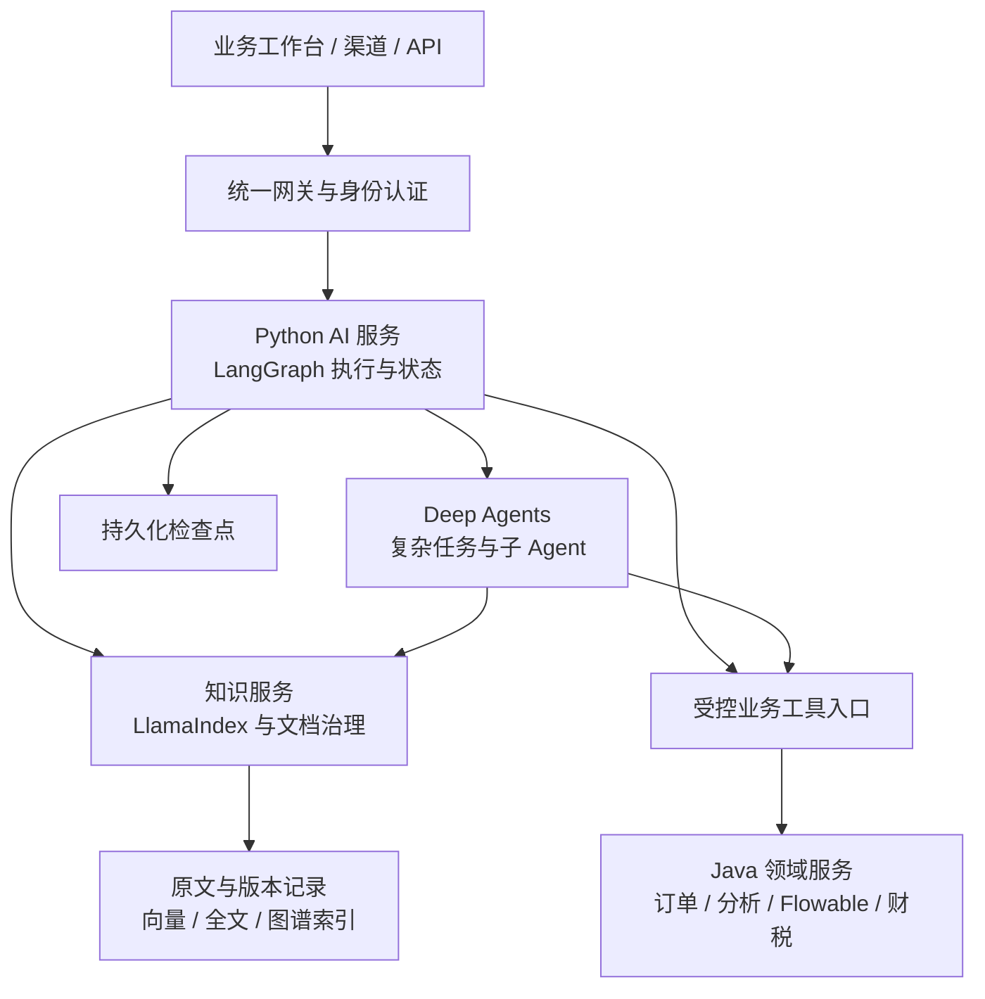

# LangGraph、Deep Agents、LlamaIndex 平台升级可行性分析

讨论与记录日期：2026-10-20。

文档状态：**保留可行性阶段的历史建议与取证；当前架构、组件和独立项目范围已在后续约定中确认，尚未完成新项目原型验证。**

后续更新（2026-10-20）：[目标架构](../design/platform-selection-20261020/BACKEND_ARCHITECTURE.md)与[技术选型](../design/platform-selection-20261020/TECH_SELECTION.md)已作为基线；用户进一步确认独立项目、全新 React 前端、知识库优先及参考资产，见[首期约定](../design/knowledge-first-20261020/BRIEF.md)。默认使用真实语义 Embedding，不采用 HashEmbedding。下文保留可行性阶段记录，旧前端复用、旧业务服务接入及第 10 节未决项均按最新约定解释；当前状态见[准备进度](../design/knowledge-first-20261020/PROGRESS_STATE.md)。候选依赖仅通过元数据解析，运行与业务原型仍未验证。

本文保存本次讨论，重点以 `langchain4j-platform` 和 `agentscope-platform` 的现有能力为参照，分析在新项目中使用三个框架升级的可行性。这里的 DeepAgent 指 LangChain 官方的 **Deep Agents（Python 包 `deepagents`）**，与旧 Java 项目中的 `DeepAgentService` 类分别理解。

## 1. 用户目标与本次范围

已确认的要求：

- 参考两个已有项目，在新的项目中开展升级。
- 评估 LangGraph、Deep Agents、LlamaIndex 的组合，重点考察现有业务与平台能力。
- 在 `/Users/liruijun/personal/LLM` 下建立新项目目录，先保存可行性分析。

本次落盘使用项目目录名 `agentic-ai-platform`，这是便于建立文档的暂定名称，不代表用户已经确定最终产品名。

本次交付为文档。尚未创建应用骨架、安装依赖、迁移数据、切换原项目路由或执行部署。独立运行范围、正式版本、服务边界、接口契约及数据迁移方案留待后续设计。

## 2. 总体结论

**技术方向可行，三个框架与现有平台的 AI 执行和知识处理能力具有较高匹配度。**

建议在新项目中：

1. 用 **LangGraph** 统一 Agent 的执行流程与状态。
2. 用 **LlamaIndex** 建设知识处理和检索层。
3. 按任务复杂度引入 **Deep Agents**，用于需要探索、分解、长上下文处理及报告产出的场景。
4. 保留或有序迁移 Java 领域服务、业务事务、权限、审计、任务管理和数据治理能力。

当前平台已经实现较多编排、恢复与治理机制，升级的预期价值主要是统一执行模型、减少部分自研编排负担、扩大数据与工具集成空间。**回答质量、执行成功率、速度和成本是否改善，必须通过同条件对比验证。**

适配程度和工作量均是基于源码与官方资料的工程判断，不是实测评分或工期承诺。

## 3. 参考项目与证据边界

### 3.1 仓库基线

| 项目 | 取证提交 | 主要职责 |
| --- | --- | --- |
| `langchain4j-platform` | `468cec425dd160e80cfc3ab378d3440a8767e4d5` | Java 业务与平台服务、知识库、对话、Web 能力门户 |
| `platform-agentscope`，本地目录 `agentscope-platform` | `7738cb7bedd1a31fd4260aa66b74572ca48d9ade` | Python Agent 编排、工具治理、可恢复 DAG 与执行诊断 |

原项目源码、配置和测试定义是现有能力的证据；README 和历史验证报告用于补充背景。记录日期核对了两个仓库的提交及工作树状态，工作树均干净。本次未重跑原项目业务测试，也未将历史通过记录当作新项目验证结果。

### 3.2 当前实际调用关系

默认 Agent 请求已经转到 Python AgentScope。Java Compose 中 `AGENT_URI` 和 `AGENT_BASE_URL` 默认指向 `agentscope-orchestrator`，原 Java `agent-service` 保留作显式回滚目标。部署环境可以覆盖默认配置，本文不据此推断所有运行环境都采用同一路由。

因此，实际升级对象主要是：

- AgentScope 的 Agent 执行、规划、DAG、工具适配和恢复机制。
- Java 侧对话与知识处理链路中的 AI 能力。
- 两者之间的契约、身份传播、任务状态、预算和诊断接口。

来源：[默认路由配置](https://github.com/lirji/langchain4j-platform/blob/468cec425dd160e80cfc3ab378d3440a8767e4d5/deploy/docker-compose.yml)、[AgentScope 执行适配器](https://github.com/lirji/platform-agentscope/blob/7738cb7bedd1a31fd4260aa66b74572ca48d9ade/src/agentscope_platform/infrastructure/agentscope/runner.py)。

## 4. 三个框架的优势、选择理由与能力分工

| 框架 | 建议职责 | 适用价值与边界 |
| --- | --- | --- |
| LangGraph | 状态图、分支、并行、循环、中断、检查点与恢复 | 统一 Agent 执行；业务幂等、权限、配额和任务调度仍需应用层保障 |
| Deep Agents | 子 Agent 委派、上下文压缩、文件工作区，以及可选任务规划 | 支撑复杂自主任务；普通查询和固定流程可以直接走明确的执行路径 |
| LlamaIndex | 数据接入、分块、索引、检索、融合与知识查询 | 扩展 RAG 管线；文档权限、版本发布和业务生命周期由知识服务负责 |

Deep Agents 基于 LangChain 的 Agent 组件并使用 LangGraph 运行时，因此两者具有自然的组合关系。LangGraph 本身也可以独立使用。模型和工具依赖按所选组件锁定，不把传递依赖误认为额外的部署服务。来源：[LangGraph 概览](https://docs.langchain.com/oss/python/langgraph/overview)、[Deep Agents 概览](https://docs.langchain.com/oss/python/deepagents/overview)。

LlamaIndex 的 Retriever 可以独立获取检索结果，适合通过受控函数或服务接口供 Agent 调用。具体结果需要映射为平台契约，保留文档 ID、版本、来源位置和权限信息。来源：[LlamaIndex Retriever](https://developers.llamaindex.ai/python/framework/module_guides/querying/retriever/)。

建议让 LangGraph 负责顶层 Agent 执行，Deep Agents 作为某类任务的执行组件或子图，LlamaIndex 聚焦知识处理。避免同时维护多套顶层 Agent 调度、重复规划循环和互相竞争的运行状态。

LangGraph 中的图表示执行与状态流转；知识检索中的 Property Graph 表示知识实体及关系，两者需要分别建模。

### 4.1 为什么选择 LangGraph：统一可控制、可恢复的 Agent 执行

本项目同时存在对话路由、DAG、规划、结果汇总、评审、重新规划和人工确认。选择 LangGraph 的主要理由，是这些流程可以用相同的状态、节点与控制流表达，方便在新项目中复用执行机制，同时保留每个业务场景的规则。

现有 AgentScope 项目已经自行实现部分恢复、预算和调度能力。因此，预期增益是统一实现与扩展方式，并利用框架提供的通用机制；仍需要保留原有业务约束。

下表中的框架能力依据官方资料；本项目用法和收益属于待验证的设计判断。

| 优势与框架能力 | 对本项目可以做的事情 | 预期收益 |
| --- | --- | --- |
| 显式状态、条件分支与循环 | 将“检索不足→补充查询→重新检索→回答”以及“规划→执行→评审→重规划”表达为清晰流程 | 分支和终止条件更易检查，增加业务步骤时修改范围更明确 |
| 确定性代码与模型节点组合 | 在发票、订单或审批助手中，先执行确定性校验，再让模型解释、补全材料或提出建议 | 关键规则由代码执行，模型负责适合推理的部分 |
| 检查点及故障恢复 | 持久化任务状态，对符合复用条件的已完成结果继续执行后续步骤 | 在语义允许时减少故障后的重复计算和用户重新提交 |
| 人工中断与继续执行 | 在业务工具调用前展示待确认参数，获得可信确认后继续任务 | 将人工决策嵌入同一任务过程，支持长时间等待与继续处理 |
| 子图与模块化组合 | 将知识问答、分析步骤、证据检查封装为可复用子流程 | 多种助手共享流程组件，减少重复维护相似逻辑 |
| 流式输出与状态检查 | 向工作台发送经脱敏的阶段、工具和结果事件；查询任务当前状态 | 用户能看到任务进展，运维人员更容易定位卡住或失败的位置 |
| 历史状态、回放与分叉 | 在隔离评测环境从某个检查点比较不同提示词、节点或处理路径 | 缩小排障范围，提高复杂 Agent 行为的可复现性 |

控制流与确定性节点能力见 [LangGraph 概览](https://docs.langchain.com/oss/python/langgraph/overview)；持久化、历史状态和回放见 [Checkpointers](https://docs.langchain.com/oss/python/langgraph/checkpointers)；流程复用与进度输出见 [Subgraphs](https://docs.langchain.com/oss/python/langgraph/use-subgraphs)、[Streaming](https://docs.langchain.com/oss/python/langgraph/streaming)。

优先落地示例：**业务客服助手**。用户提出售后问题后，流程依次完成身份检查、订单查询、政策检索、材料补充、人工确认和流程发起。LangGraph 组织步骤与恢复位置，订单和审批仍由领域服务处理。图回放会重新执行检查点之后的节点，涉及业务副作用时须使用隔离环境或防重机制，不能当作业务回滚。

### 4.2 为什么选择 Deep Agents：加快复杂任务型助手建设

对于“查一条订单”这类明确任务，普通工具调用或固定图流程已经足够。Deep Agents 更适合“阅读一批材料、分解问题、反复查证、整理结论并输出报告”这类开放任务。

选择它的理由，是可以复用子 Agent、工作区、上下文整理等通用能力，把开发重点放在专业工具、任务标准和产出质量上。它使用 LangGraph 运行时，适合在已经选择 LangGraph 的项目中按需引入。

| 优势与框架能力 | 对本项目可以做的事情 | 预期收益 |
| --- | --- | --- |
| 可选任务规划与待办管理 | 将材料审查拆成资料收集、逐项比对、缺口识别和报告整理 | 便于呈现任务分解与完成进度，降低复杂任务漏步骤的风险 |
| 专业子 Agent | 分别配置知识检索、数据分析、政策核对与结果审查角色的提示词和工具 | 任务职责更集中，便于按角色调整工具与模型 |
| 子 Agent 上下文隔离 | 将大量探表、检索和文档阅读放在子任务内，向主 Agent 返回必要结论与证据 | 减少无关中间内容挤占主上下文，便于主 Agent 专注协调 |
| 上下文压缩与大结果转存 | 对长会话整理摘要，对大工具结果按需读取 | 让长任务更易在有限上下文内持续执行；关键信息保真需评测 |
| 可配置文件工作区 | 保存材料摘录、对照表、中间结论和报告草稿，按任务逐步更新 | 支持从一次回答扩展为可检查、可继续加工的任务产物 |
| Skills 按需加载 | 将材料检查方法、报告结构和业务操作指引整理为可复用技能 | 团队经验可以作为受维护资产供不同助手使用，减少重复编写提示词 |
| 自定义工具和人工介入 | 调用现有知识、订单、分析、流程工具，在关键动作前等待确认 | 将复杂任务与真实业务连接，保留人工控制点 |

任务规划在当前官方文档中为可选能力；规划工具记录待办，任务拆解质量仍依赖模型与提示词。[Deep Agents 概览](https://docs.langchain.com/oss/python/deepagents/overview)

子 Agent 可独立配置并隔离中间上下文，但上下文隔离不等于租户安全隔离，也不保证多 Agent 一定优于单 Agent。[Subagents](https://docs.langchain.com/oss/python/deepagents/subagents) 工作区与摘要能力见 [Context engineering](https://docs.langchain.com/oss/python/deepagents/context-engineering)；技能加载机制见 [Skills](https://docs.langchain.com/oss/python/deepagents/skills)。

优先落地示例：**跨文档材料分析助手**。用户提供一组合同、政策或采购材料后，助手按专题分工，调用知识检索与业务工具，汇总为“结论、依据、冲突、缺失材料、待人工确认事项”。这些是拟建设的业务流程；文件导出格式、专业规则及外部数据工具需要另行实现或接入。

### 4.3 为什么选择 LlamaIndex：提高知识接入和检索策略的扩展效率

现有知识服务已具备多路召回、融合、重排、解析和治理能力。选择 LlamaIndex 的理由，是把数据加载、转换、检索与结果组织建立在可组合组件上，更方便增加数据源、比较检索策略和构建复杂知识查询。

它更直接影响“能否找到适当证据、怎样处理材料”的开发方式，实际回答效果仍需要数据、模型和评测共同验证。

| 优势与框架能力 | 对本项目可以做的事情 | 预期收益 |
| --- | --- | --- |
| Reader / 数据连接器 | 将不同来源的数据转为带文本与元数据的 Document，再接入统一处理流程 | 降低适配不同数据源的重复工作；具体连接器仍需评估质量与权限 |
| 可组合入库管线 | 组合分块、元数据抽取、Embedding 与索引步骤，比较不同处理方案 | 便于调整解析和检索前处理策略，减少把实验逻辑写死在主流程中 |
| 转换缓存与文档变更检测 | 对输入和转换条件一致的处理结果复用，对变化的内容重新处理 | 在命中缓存且满足隔离要求时减少重复处理与模型调用 |
| 检索器组合与查询扩展 | 将向量、关键词和不同查询的候选组织到统一检索流程 | 更方便探索不同问题类型的召回组合 |
| RRF 等融合方式 | 合并多个检索来源的排序结果，再结合所需重排策略 | 提供可比较的相关性优化手段；效果以现有质量集验证 |
| Property Graph 与自定义图检索 | 查询实体、关系及相关原文，组合图谱和文本检索 | 支持从单段匹配扩展到有关联关系的知识问题 |
| 可独立调用的 Retriever | 将检索结果交给 LangGraph、Deep Agents 或现有 HTTP 接口 | 不同助手共享知识服务，降低知识处理与 Agent 实现之间的耦合 |

数据连接器能力见 [Data Connectors](https://developers.llamaindex.ai/python/framework/module_guides/loading/connector/)；转换、缓存与文档更新见 [Ingestion Pipeline](https://developers.llamaindex.ai/python/framework/module_guides/loading/ingestion_pipeline/)。

多源查询与融合见 [Reciprocal Rerank Fusion](https://developers.llamaindex.ai/python/framework/integrations/retrievers/reciprocal_rerank_fusion/)；关系检索与定制能力见 [Property Graph](https://developers.llamaindex.ai/python/framework/module_guides/indexing/lpg_index_guide/)；独立检索接口见 [Retriever](https://developers.llamaindex.ai/python/framework/module_guides/querying/retriever/)。

优先落地示例：**有证据的企业知识助手**。统一接入政策、产品资料和业务文档，按问题检索不同来源，再由应用组织答案及出处。页码、文档版本和引用准确性依赖解析器、元数据契约和引用校验，接入框架不会自动保证。

### 4.4 三者组合后可以建设哪些业务能力

下表是结合现有资产提出的建设方向，不代表这些完整业务闭环已在新项目实现。

| 业务场景 | 可以提供的任务与产物 | 三框架如何协作 | 业务收益与前置条件 |
| --- | --- | --- | --- |
| 企业知识与 IT 服务助手 | 政策问答、故障排查步骤、证据引用、工单草稿 | LlamaIndex 找证据；LangGraph 控制问答和转人工；复杂排查按需启用 Deep Agents | 有望减少资料查找和重复沟通；需接入真实知识、员工权限及工单系统 |
| 合同、采购与招投标材料助手 | 条款对照、缺项清单、材料冲突与审查报告 | LlamaIndex 检索材料；Deep Agents 分专题分析；LangGraph 控制校验与人工确认 | 有望缩短材料整理时间并提高检查覆盖；需业务规则、版本管理及专业复核 |
| 经营分析助手 | 探表、受控查询、指标解释、分析报告 | LangGraph 管理查询与校验；LlamaIndex 提供指标定义；Deep Agents 组织多问题分析 | 有望减少跨表查询和报告整理工作；先修复 SQL 护栏并建立指标口径 |
| 售后与退款助手 | 订单核对、政策匹配、材料补充、确认后发起流程 | LlamaIndex 提供政策；LangGraph 管理业务步骤；复杂材料调查可用 Deep Agents | 有望缩短人工受理与材料补齐时间；实际审批、退款及幂等由业务系统负责 |
| 发票与财税材料助手 | 确定性风险结果、政策依据、异常说明与待补材料 | 规则引擎执行检查；LlamaIndex 找政策；LangGraph 编排；复杂批次按需委派子 Agent | 有望降低证据整理与解释成本；金额计算和最终业务判断保留确定性规则与复核 |
| 跨文档研究与报告助手 | 问题分解、多来源核对、专题结论、综合报告草稿 | Deep Agents 组织任务；LlamaIndex 检索私有材料；LangGraph 管理阶段及恢复 | 有望提升复杂材料处理的连续性；需来源可信度、引用检查与产物验收 |

例如，“分析一批采购材料并形成审查报告”的拟议过程为：LangGraph 建立任务及控制节点，Deep Agents 分配分析子任务，各子任务通过 LlamaIndex 获取获授权证据，领域工具核对结构化业务数据，再经过完整性检查与人工复核形成产物。收益来自整个业务链路的协作，需要端到端评测。

### 4.5 为什么采用这个组合，以及何时只使用其中一部分

| 选型理由 | 与本项目的关联 | 使用原则 |
| --- | --- | --- |
| 执行、任务助手、知识处理各有明确职责 | 两个原项目本身已有领域服务、Agent 与知识服务边界 | 沿已有边界接入，框架内部对象不扩散为公共业务契约 |
| LangGraph 与 Deep Agents 共享执行生态 | 已确定评估图执行，又需要复杂任务助手 | 复用运行时能力，避免另建竞争的顶层调度 |
| LlamaIndex 可作为独立知识能力被调用 | 同一知识库要支持对话、Analyst、Process 及多个 Agent | 用一个受治理知识入口服务不同助手 |
| 可以分阶段比较与替换 | 已有代码、评测集和接口可作为基线 | 先验证明确流程与知识检索，再增加复杂自主任务 |

这个选择不意味着其他框架无法实现同样能力，也不意味着必须一次重写所有模块。若目标仅是新增数据源或改善检索，可先在现有 AgentScope 外围评估 LlamaIndex；若目标是新项目统一执行与恢复，LangGraph 的价值更直接；需要长任务工作区、上下文管理和专业委派时，再评估 Deep Agents 的增量收益。

“是否有必要引入”应以任务需要和维护成本判断。三个框架的优势互补，是本次建议组合的理由；只有对比验证后，才能把预期收益记为已获得收益。

## 5. 按现有能力逐项评估

表中“高”表示有明确承接路径，不表示无需定制或已经通过兼容验证。

| 当前能力 | 新项目承接方式 | 可行性与主要工作 |
| --- | --- | --- |
| 多轮对话、SSE、意图路由、模型级联 | LangGraph 对话流程与模型适配层 | 高；迁移会话语义、流式事件、取消和错误契约 |
| ReAct、Planner、DAG、Critic/Replan | 显式 LangGraph 状态图；复杂任务接 Deep Agents | 高；重新表达依赖、失败传播、终止条件和复用规则 |
| Chain / Vote / Reflexion | 顺序、并行汇总与循环子图 | 高；投票、停止和预算策略由业务定义 |
| 向量、关键词、ES BM25、GraphRAG 四路召回 | LlamaIndex 检索组件与已有存储适配器 | 高；对齐中文检索、租户范围、分数与来源元数据 |
| RRF、重排、查询扩展 | 多检索器融合与检索后处理 | 高；以既有评测集验证排序与引用，避免重复查询扩展 |
| 文件解析、OCR、结构化分块 | LlamaIndex 管线连接已有或新选解析器 | 中高；逐格式验证解析质量、隔离、资源预算与来源定位 |
| 异步入库、内容去重、版本发布 | 知识服务拥有生命周期；框架执行转换与索引步骤 | 定制工作较多；保留持久任务、并发去重、准备快照及可见版本语义 |
| 长期画像和记忆治理 | LangGraph 持久化能力接独立治理层 | 中高；确认、修正、固定、遗忘、启停及审计仍需实现 |
| Analyst / NL2SQL | 探表、生成、校验、执行与解释的受控图 | 高但有安全前置条件；独立执行 SQL 权限、资源和查询约束 |
| 退款审批与订单查询 | Agent 调用 Java 领域 API | 高；保留业务权限、Flowable、幂等与事务边界 |
| 发票风险审查 | 确定性规则与 AI 辅助分析协作 | 高；规则结果和模型建议分开，保持依赖失败降级 |
| 多租户、SSO、RBAC/ReBAC、审计 | 网关、身份及领域授权层统一提供 | 三框架不直接覆盖；检查点、工具、检索和记忆均需接入 |
| 异步任务、租约、恢复、取消 | 平台任务管理结合 LangGraph 图内持久化 | 可行但复杂；明确状态所有权、接管及终态协调 |
| 模型预算、费用、追踪与诊断 | 公共预算与观测机制接入新运行时 | 可行；所有子 Agent、重试及恢复共享相应额度，未知用量不可当零 |
| MCP/A2A、钉钉/飞书、Webhook | 协议适配层接新 AI 服务 | 可行；分别验证身份、流式事件、回执与错误映射 |
| 图像理解、图片检索、语音闭环 | 独立模型与媒体适配能力 | 可行；模型接入、媒体处理、延迟和部署需要另行验证 |
| Web 门户与质量评测 | 通过稳定 API/SSE 对接，迁移已有用例 | 可复用；新框架不会自动提供完整业务工作台或验收集 |

关键源码依据：

- [知识检索编排](https://github.com/lirji/langchain4j-platform/blob/468cec425dd160e80cfc3ab378d3440a8767e4d5/knowledge-service/src/main/java/com/lrj/platform/knowledge/KnowledgeQueryService.java)：召回、融合、已发布版本过滤、文档授权、重排。
- [入库提交](https://github.com/lirji/langchain4j-platform/blob/468cec425dd160e80cfc3ab378d3440a8767e4d5/knowledge-service/src/main/java/com/lrj/platform/knowledge/ingest/job/IngestionSubmissionService.java)：幂等、内容哈希、可见权限及并发竞争。
- [索引写入与版本提交](https://github.com/lirji/langchain4j-platform/blob/468cec425dd160e80cfc3ab378d3440a8767e4d5/knowledge-service/src/main/java/com/lrj/platform/knowledge/ingest/job/DefaultIngestionSinkProcessor.java)：检索存储写入、授权关系建立、注册表发布。
- [记忆治理契约](https://github.com/lirji/langchain4j-platform/blob/468cec425dd160e80cfc3ab378d3440a8767e4d5/conversation-service/src/main/java/com/lrj/platform/conversation/memory/profile/GovernedProfileStore.java)：确认、版本、代次、遗忘与审计。
- [DAG 恢复](https://github.com/lirji/platform-agentscope/blob/7738cb7bedd1a31fd4260aa66b74572ca48d9ade/src/agentscope_platform/application/dag_recovery.py)：检查点、输入指纹、恢复及累计预算。
- [受治理工具](https://github.com/lirji/platform-agentscope/blob/7738cb7bedd1a31fd4260aa66b74572ca48d9ade/src/agentscope_platform/infrastructure/agentscope/governed_tools.py)：业务调用、错误处理和未知结果查询。

现有文档级 ReBAC 支持 `disabled / shadow / enforce`，默认关闭，不能把“已有集成代码”记为“所有环境已强制授权”。新项目需根据目标业务明确策略。

## 6. 建议的新项目架构

以下为拟议逻辑边界，不是已批准的物理部署清单。

### 6.1 数据与状态所有权

| 状态或数据 | 建议负责方 | 一致性要求 |
| --- | --- | --- |
| 订单、审批、发票规则结果 | 对应领域服务 | 业务事务和权限由领域服务执行；模型不得绕过 API 直接修改业务库 |
| 文档原文、版本、发布记录、权限引用 | 知识服务 | 转换与索引任务完成后按发布协议提交；失败期间维持既有可见版本规则 |
| Agent 图内状态与恢复位置 | LangGraph 持久化层 | 检查点绑定运行和执行版本，定义保留及清理规则 |
| 任务领取、租约、取消请求、对外状态 | 平台任务管理 | 通过统一 `run_id` 关联执行；终态有明确提交协议与差异对账 |
| 用户长期记忆与治理记录 | 记忆治理模块 | 未确认内容不能直接作为已批准画像；更正和遗忘覆盖相关召回副本 |
| 预算与用量 | 统一预算及计量机制 | 子 Agent、重试、恢复共同消费预算，费用缺失不得按零计 |

一个执行入口推进同一次运行，平台任务管理和 LangGraph 不应各自重复领取、独立重试同一业务动作。检查点可以证明某段执行状态已保存，不能替代领域数据库的业务提交结果。

### 6.2 新旧项目的关系

新仓库可以先通过现有 HTTP 契约复用 Java 领域服务，完成 AI 层原型与对比评测。若最终要求新平台独立部署、完全退出旧系统，需要把领域服务、数据及运行配置纳入迁移范围，工作量明显高于替换 AI 层。

迁入 Python 的 AI 能力统一接入新的模型适配层；暂留 Java 的能力沿用原接口，按能力逐项退出 LangChain4j。避免同一链路重复管理模型上下文、用量和重试。是否最终全面退出 LangChain4j，尚待正式范围确认。

### 6.3 部署与依赖边界

框架选型不等于选择云平台。LangSmith、LlamaParse 等产品应按需求单独评估，不因引入 SDK 自动增加采购或运行依赖。

LlamaIndex Framework 是开源 RAG/Agent 工具集；LlamaParse 是单独的文档处理产品。是否引入 LlamaParse，应按复杂文档效果、部署条件和成本验证；现有本地 OCR 仍是候选方案。来源：[LlamaIndex 官方产品说明](https://developers.llamaindex.ai/home/)。

正式 Python、LangGraph、Deep Agents、LlamaIndex 及插件版本尚未选择。原 Python 项目声明 `>=3.12,<3.14` 可作为验证起点，不代表新框架组合已经完成依赖解析和运行验证。

## 7. 迁移难点与风险

### R1：DAG 调度语义不同，性能收益不能直接推定

现有调度器在依赖完成后立即释放后继任务。LangGraph 的 Pregel 运行时按 super-step 执行，步骤内更新在后续步骤可见。直接照搬节点结构可能改变关键路径耗时。

应以包含快慢分支、汇合和失败节点的真实任务比较调度、延迟与资源占用，再决定节点和子图粒度。来源：[当前依赖就绪调度器](https://github.com/lirji/platform-agentscope/blob/7738cb7bedd1a31fd4260aa66b74572ca48d9ade/src/agentscope_platform/application/dag_scheduler.py)、[LangGraph 运行机制](https://docs.langchain.com/oss/python/langgraph/pregel)。

### R2：恢复与人工中断不提供业务副作用的一次性保证

LangGraph 恢复中断时会重新执行相关节点逻辑。退款、写工具等仍需稳定幂等键、参数绑定确认、权限复核、未知结果查询与必要补偿。不能把恢复执行等同于外部业务操作恰好执行一次。来源：[官方中断与幂等说明](https://docs.langchain.com/oss/python/langgraph/interrupts)。

现有退款工具在请求结果不明时查询原回执，避免无条件重发写请求，这项设计应保留。[受治理退款调用](https://github.com/lirji/platform-agentscope/blob/7738cb7bedd1a31fd4260aa66b74572ca48d9ade/src/agentscope_platform/infrastructure/agentscope/governed_tools.py)。

验收至少覆盖：提交后响应丢失、检查点写入失败、重复恢复、确认过期和执行者失去租约。暂停前已有的预算及截止时间不得因恢复重置。

### R3：检索组件与知识生命周期存在语义差异

LlamaIndex 提供多检索器融合和 Property Graph 组件，但实际检索效果仍由数据、分块、模型、中文分词、过滤和参数共同决定。来源：[RRF 融合检索](https://developers.llamaindex.ai/python/framework/integrations/retrievers/reciprocal_rerank_fusion/)、[Property Graph](https://developers.llamaindex.ai/python/framework/module_guides/indexing/lpg_index_guide/)。

其 Ingestion Pipeline 支持基于文档 ID 与哈希的去重及更新，但这不等于当前的租户范围、可见权限、并发提交与版本发布协议。来源：[Ingestion Pipeline 文档管理](https://developers.llamaindex.ai/python/framework/module_guides/loading/ingestion_pipeline/)。

迁移时应：

- 保留来源 ID、文档版本、页码或其他定位信息和权限上下文。
- 保持仅查询已发布版本、在要求强制授权时先判权再向重排或生成模型提供内容。
- 使用独立索引命名空间进行验证；分块或 Embedding 模型变化时重建相应索引。
- 对未改变的向量，先验证维度、模型、ID 和元数据兼容性，再决定是否复用。
- 对独立知识来源和版本保留各自身份，避免只按相同正文错误合并。

### R4：文件工作区、记忆与检查点需要统一隔离

Deep Agents 的工作区与跨线程存储需要按可信租户、用户及任务划分命名空间。命名空间不能由模型任意选择，服务端仍需验证访问权。HTTP 服务中的代码执行使用受控沙箱，不能将宿主机目录直接当作多租户安全边界。来源：[Deep Agents 后端与隔离说明](https://docs.langchain.com/oss/python/deepagents/backends)。

会话存储、长期记忆、知识索引各有用途。长期记忆继续经过确认和审计；检查点和工作区中的历史副本也需明确保留与清理规则，避免更正或遗忘后重新召回旧内容。生产持久化方案必须验证进程重启后的恢复，内存示例不能作为生产证据。来源：[LangGraph 持久化说明](https://docs.langchain.com/oss/python/langgraph/persistence)。

### R5：现有安全缺口不会因换框架自动消失

既有评估记录了 SQL 护栏不足、MCP 写工具约束可被配置弱化，以及执行结束与业务成功需要区分等问题。讨论时核对的代码仍保留相关实现。

这些问题应转化为新项目验收用例，不能把旧实现整体复制后视为通过安全验收。只读数据库账号不能自动完成行级权限隔离；框架工具调用成功也不能证明业务成功。

来源：[Java 项目评估](https://github.com/lirji/langchain4j-platform/blob/468cec425dd160e80cfc3ab378d3440a8767e4d5/docs/平台工程/项目优势不足与业务接入评估-20261014.md)、[AgentScope 项目评估](https://github.com/lirji/platform-agentscope/blob/7738cb7bedd1a31fd4260aa66b74572ca48d9ade/docs/assessments/project-business-assessment-20261014.md)。上述记录不构成本次对线上数据泄漏或生产事故的证明。

### R6：框架叠加增加运行和维护成本

Deep Agents 的委派与长任务处理可能增加模型调用、上下文和运行时间。三个 SDK 的消息、工具、文档对象、回调和版本也需要适配。

建议在边界使用语言中立 DTO，将框架类型限制在适配器中；统一模型入口、端到端超时和预算，避免框架层与平台层重试放大。框架内部检查点允许使用适配的持久化格式，但不作为业务 API 或跨服务公共任务格式。

旧 AgentScope 运行状态不能假定能直接导入 LangGraph。后续需明确已有任务完成、终止或迁移的策略，以及执行版本不兼容时的处理。

## 8. 升级收益与投入判断

| 范围 | 预期收益 | 相对投入与约束 |
| --- | --- | --- |
| LangGraph 统一 Agent 执行 | 执行路径、人工介入与恢复使用统一模型 | 中高；现有自研调度、恢复和预算语义需逐项映射 |
| LlamaIndex 知识层 | 更方便组合检索和处理管线、验证新策略 | 中高；解析与检索可组件化，知识治理仍需保留 |
| 选择性使用 Deep Agents | 复杂材料分析、跨文档研究与报告更易组织 | 场景相关；需要验证相对普通图流程的质量和成本增益 |
| 新平台全量独立运行 | 产品与运行时可以独立演进 | 高；包含领域服务、数据库、协议、前端与运维迁移 |
| 全部业务改写为 Python | 可统一主要应用语言 | 很高；当前没有证据证明收益足以覆盖 Java 业务重写成本 |

推荐优先验证“企业知识问答＋跨文档分析报告”。普通问答、订单查询和固定审批路径走明确流程，需要探索、分解与大量材料整理的任务再启用 Deep Agents。

保留 Java 领域层是本次建议，尚非用户已批准的最终技术决策。暂不承诺工期、吞吐、成本降低比例或回答质量提升幅度。

### 8.1 收益如何对应到工程和业务结果

| 收益方向 | 形成收益的机制 | 建议记录的指标 |
| --- | --- | --- |
| 开发与接入效率 | 复用图流程、任务组件、数据连接器与检索接口 | 同等验收范围下的新助手/新数据源接入工时，新增步骤涉及的修改点与回归范围 |
| 故障恢复与排障 | 利用持久状态、检查点和可检查的执行轨迹 | 故障后恢复成功率、需要重做的节点数、排障耗时；与当前恢复实现同条件比较 |
| 知识与回答质量 | 对数据处理、多路召回和关系检索进行可重复实验 | Recall@K、排序质量、引用准确率、无依据结论比例及权限用例结果 |
| 复杂任务交付质量 | 专业委派、上下文整理、工作区与结果检查共同组织长任务 | 业务任务成功率、要求覆盖率、遗漏项数量、人工修订量 |
| 用户操作体验 | 展示任务进度、允许补充信息、人工确认后继续 | 首次可见反馈时间、任务放弃率、补充材料次数、人工处理时间 |
| 资源和运行费用 | 在合法复用范围内使用转换缓存、已完成结果和模型分工 | 每个成功任务的总费用、模型调用数、Token、缓存命中率和运行时间 |
| 长期维护与演进 | 按框架职责和业务边界集中适配，复用质量与安全用例 | 一次框架升级的适配范围、回归投入、线上缺陷与回退耗时 |

这些是建议采用的衡量口径。当前没有新平台实测数值；项目首先需要确定基线、样本、通过阈值与记录方法。开发效率按相同验收范围比较，不能以减少代码行数直接替代。

### 8.2 收益成立的条件与成本口径

预期收益需要以下条件共同成立：

- **组件减少了实际重复工作**：如果接入后仍保留多套相同职责的调度、摘要、检索与重试，维护成本可能增加。
- **复杂任务确有分解价值**：子 Agent 会产生协调和模型调用成本；必须与直接 LangGraph 流程或单 Agent 比较。
- **缓存与恢复结果仍然有效**：输入、权限、文档版本或执行版本变化时应重新检查，不能为节省调用而使用失效结果。
- **治理能力与新运行时打通**：预算、工具权限、租户隔离、确认及引用校验进入实际执行路径，框架功能才能转化为业务能力。
- **成本统计覆盖完整链路**：包含规划、子 Agent、摘要、评审、Embedding、重排、解析、检查点存储及可选外部服务；不能只比较最终生成回答的一次调用。

更准确的优化目标是：在满足业务质量、安全与延迟要求的前提下，降低每个成功任务的综合投入，包括运行费用、开发维护和人工处理成本。新框架带来的能力扩展可以成为采用理由，是否经济则另由评测确认。

## 9. 建议验证路线

| 阶段 | 交付能力 | 核心验证 |
| --- | --- | --- |
| 第一阶段：知识问答 | 文档上传、发布、带来源检索、多轮对话 | 解析成功率、检索质量、引用准确率、权限隔离、流式与查询延迟 |
| 第二阶段：只读复杂任务 | 多文档分析、子任务执行、综合报告 | 同时比较旧项目、直接 LangGraph 和引入 Deep Agents 的结果、耗时、Token 与人工修订量 |
| 第三阶段：恢复与业务动作 | 中断恢复、人工确认、退款流程发起 | 崩溃、权限变化、重复请求、响应丢失、预算不重置和取消后的业务结果 |
| 后续扩展 | Analyst、渠道、MCP/A2A、多模态等 | 逐项验证业务契约、身份映射、结果语义和故障处理 |

验证方法：

1. 从现有测试、检索质量集、Shadow 用例及解析样本提取基线，并检查数据使用权限。
2. 使用相同数据、模型配置与评测口径；将模型变化和框架变化的影响分开。
3. 必测跨租户、权限撤销、未发布版本、重复文件、工具拒绝、恢复与副作用防重。
4. LangGraph 及 Deep Agents 子任务共同纳入预算、耗时、错误、用量和费用归因。
5. 预先确定各项通过阈值，再进行原型评估；安全与业务不变量必须满足，质量、性能和成本阈值按目标场景确定。
6. 使用隔离数据和索引；涉及写操作的对比通过替身或专用测试环境完成，避免新旧双跑重复产生业务效果。

已有聚焦测试可以用于提取预期，例如 [DAG 恢复测试](https://github.com/lirji/platform-agentscope/blob/7738cb7bedd1a31fd4260aa66b74572ca48d9ade/tests/test_dag_recovery.py)、[累计预算测试](https://github.com/lirji/platform-agentscope/blob/7738cb7bedd1a31fd4260aa66b74572ca48d9ade/tests/test_dag_budget.py) 和 [确认防重放测试](https://github.com/lirji/platform-agentscope/blob/7738cb7bedd1a31fd4260aa66b74572ca48d9ade/tests/test_tool_confirmation.py)。测试文件存在不等于新实现已通过这些检查。

## 10. 后续设计需要明确的事项

- 首期是独立 AI 服务，还是必须覆盖完整平台独立运行。
- Java 领域服务的保留、复用与迁移范围，以及是否最终退出 LangChain4j。
- 首批业务用户、主要任务和业务成功标准。
- 哪些已有接口与 SSE 事件必须兼容，哪些可以发布新版本。
- 是否迁移历史文档、画像和会话，以及在途任务如何处理。
- 模型提供方、数据出境与解析部署约束；是否选用独立商业服务。
- 团队与运行环境、质量目标、容量目标、可接受延迟及成本。
- 三框架与连接器的兼容版本、持久化后端、执行隔离和升级策略。

这些事项不阻碍保存本次分析，但会影响正式架构、工作量和实施顺序。当前文档不将未决项写成已批准决策。

## 11. 当前验证状态

| 项目 | 状态 |
| --- | --- |
| 原项目核心源码、配置与测试定义取证 | 讨论阶段已完成；本次保存来源和固定提交 |
| 官方框架能力核对 | 2026-10-20 已核对，并在优势与收益增补时补查检查点、流式、子图、子 Agent、上下文、Skills、连接器及检索资料；动态文档以引入时复核为准 |
| 三框架联合依赖解析与启动 | 未执行 |
| 新项目代码与业务契约实现 | 未执行 |
| 真实模型质量、性能与费用对比 | 未执行 |
| 新系统恢复、隔离与业务副作用验证 | 未执行 |
| 数据迁移、路由切换与部署 | 未执行 |

本文的“可行”指架构与能力层面存在合理承接路径，不代表已经达到上线条件。文档本身的检查结果记录在项目根目录 [CODEX_PROGRESS.md](../../CODEX_PROGRESS.md)。
